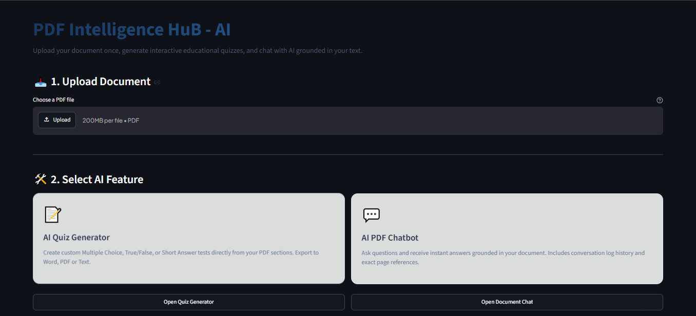
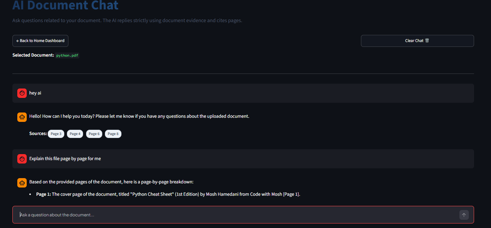
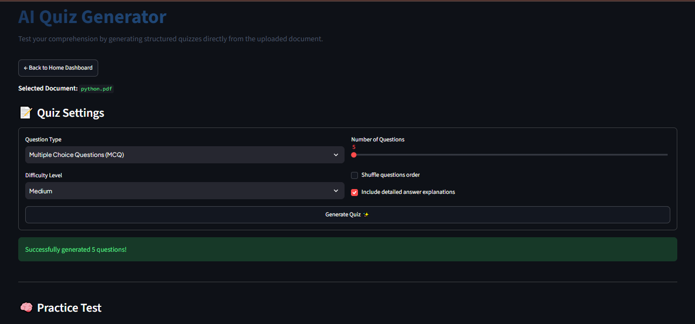

# PDF Intelligence HuB AI

**An AI-powered PDF analysis platform that helps users interact with documents, get answers, and generate quizzes.**

## 🚀 Live Demo

**[Try PDF Intelligence HuB AI](https://pdf-intelligence-app-ai-bt29rz9d5t7hvzff9925qf.streamlit.app/)**

> Open the live application, upload a PDF, and explore its AI-powered document features.

## ✨ Key Features

* **AI PDF Chat** — Ask questions about an uploaded PDF.
* **Document Understanding** — Extract useful information from documents.
* **Automatic Quiz Generation** — Generate quizzes from PDF content.
* **Interactive Interface** — Explore document information through a simple web app.

## 🛠️ Technology

* Python
* Streamlit
* Google Gemini API
* PDF processing and AI-powered question answering

## 🧪 How to Test the Live Demo

1. Open the live demo.
2. Upload a non-sensitive sample PDF.
3. Ask a question related to the document.
4. Review the AI-generated answer.
5. Try the quiz-generation feature.

## 🔐 Privacy and Source Code

The original source-code repository is private. This public repository serves as a project showcase and provides access to the live demo.

## 👨‍💻 Project

**PDF Intelligence HuB AI** — AI-powered document interaction and analysis.
## 📸 Screenshots

### Application Interface

### AI-Powered PDF Chat

### Automatic Quiz Generation

